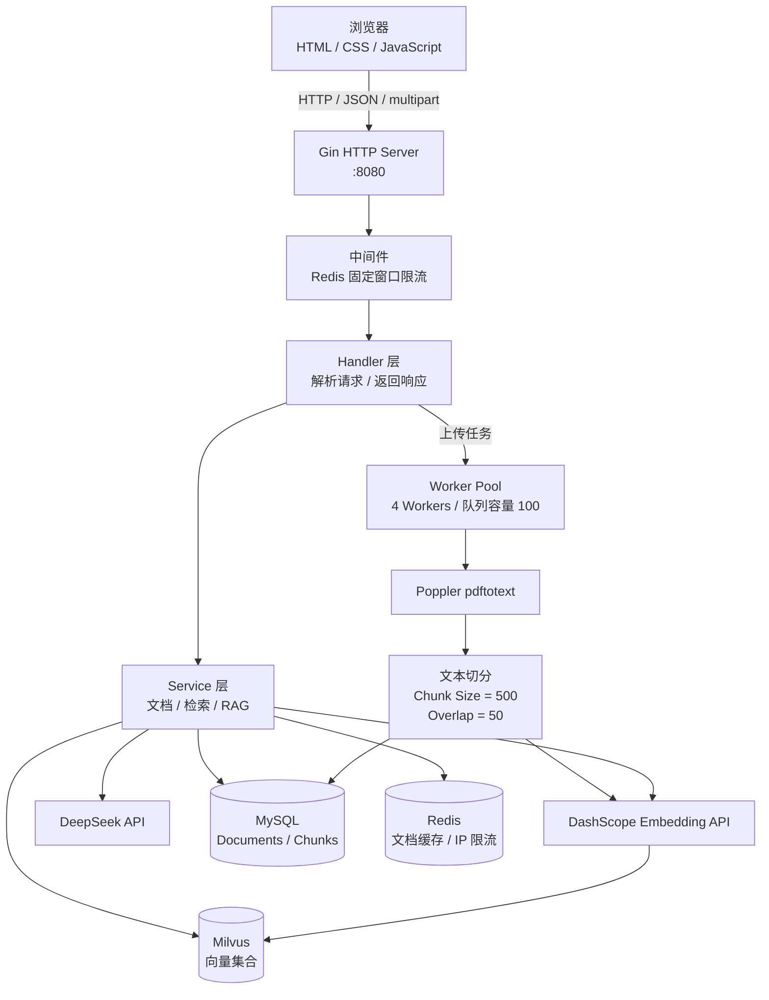
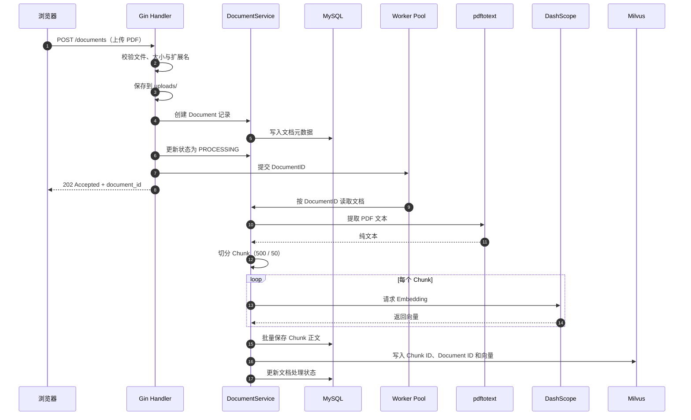
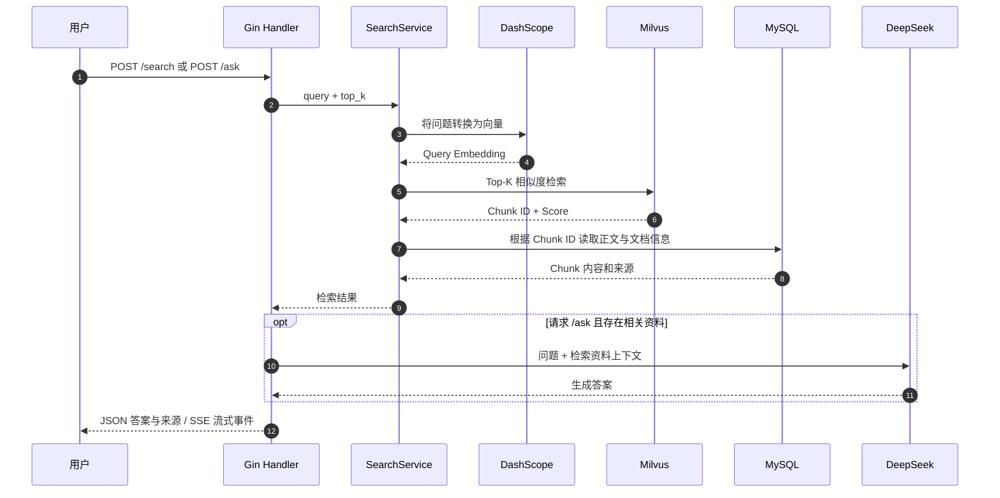

# GoRAG：基于 Go 的 PDF 知识库与 RAG 问答系统

<p align="center">
  <strong>Upload PDFs · Retrieve Relevant Chunks · Generate Grounded Answers</strong>
</p>

<p align="center">
  
  
  
  
  
  
</p>

GoRAG 是一个使用 **Go + Gin** 构建的 PDF 知识库与检索增强生成（Retrieval-Augmented Generation，RAG）应用。用户上传 PDF 后，系统在后台提取文本、切分文本块（Chunk）、调用 Embedding API 生成向量并写入 Milvus；用户提问时，系统先检索知识库中的相关片段，再将检索结果交给 DeepSeek 生成回答，并返回可追溯的来源信息。

- **代码仓库：** https://github.com/xueruichan/AI-RAG-Go-
- **前端入口：** `http://localhost:8080/web/`
- **健康检查：** `http://localhost:8080/health`
- **项目定位：** 个人学习、技术实践与面试演示项目。
- **在线演示：** 当前仓库未提供固定的公网演示地址。

> **项目状态说明：** 当前版本以共享知识库为主，尚未实现完整的注册登录、用户级数据隔离和生产级权限体系。请使用非敏感的测试 PDF；不要将本项目直接用于存储不同用户的私密文档或未经保护地开放公网访问。

## 目录

- [功能概览](#功能概览)
- [技术栈](#技术栈)
- [系统架构](#系统架构)
- [核心处理流程](#核心处理流程)
- [项目结构](#项目结构)
- [运行环境与准备](#运行环境与准备)
- [本地启动：Docker Compose](#本地启动docker-compose)
- [本地开发：直接运行 Go 服务](#本地开发直接运行-go-服务)
- [API 接口](#api-接口)
- [测试流程](#测试流程)
- [常用运维命令](#常用运维命令)
- [常见问题](#常见问题)
- [安全与当前限制](#安全与当前限制)
- [后续计划](#后续计划)
- [许可证](#许可证)

## 功能概览

### 文档管理
- 上传 PDF、查看文档列表、查询单个文档状态、删除文档。
- 单个 PDF 最大 **10 MiB**，拒绝空文件和非 `.pdf` 扩展名。
- 清理客户端文件名，并使用时间戳生成服务器侧存储文件名，降低同名覆盖风险。
- 上传后立即返回 `202 Accepted`，解析和索引在后台执行；`202` 表示任务已接收，不表示索引已经完成。

### 后台异步处理
- 使用 Go goroutine、channel 和 `sync.WaitGroup` 实现 Worker Pool。
- 当前服务启动 **4 个 Worker**，任务 channel 缓冲容量为 **100**。
- Worker 负责提取 PDF 文本、切分文本、生成 Embedding、写入 MySQL 和 Milvus，并更新文档状态。

### 向量检索与 RAG 问答
- 使用 DashScope Embedding API 将文本块和用户问题转换为向量。
- 使用 Milvus 执行 Top-K 向量相似度检索；当前集合名为 `gorag_document_chunks_v1`，当前向量维度为 **1024**，索引使用余弦相似度。
- MySQL 保存文档元数据和 Chunk 正文；Milvus 保存 Chunk ID、Document ID 和向量。检索时先查向量，再根据 Chunk ID 取回正文和来源。
- 使用 DeepSeek API 根据检索资料生成回答，并返回来源文档、Chunk 序号和相似度分数。
- 如果检索不到资料，当前 RAG 服务会返回“根据当前知识库资料无法确定”，而不是在缺少知识库证据时继续调用模型生成答案。

### Web 与流式响应
- 提供 HTML、CSS、JavaScript 前端，支持 PDF 上传、文档列表、语义检索和智能问答。
- Gin 同时提供前端静态资源和后端 API，前端通过相对路径调用 API。
- `POST /ask/stream` 使用 **Server-Sent Events（SSE）** 推送状态、来源和回答增量，浏览器可以逐步显示生成内容。

### 缓存与请求限流
- Redis 用于文档详情缓存；当前缓存 TTL 为 **5 分钟**。
- Redis 也用于固定窗口限流，当前配置为**每个客户端 IP 每分钟最多 60 次请求**。
- 文档状态变化或文档删除时，会尝试清理相应缓存。

## 技术栈

| 模块 | 技术 | 职责 |
|---|---|---|
| 后端语言 | Go 1.26.5 | API 服务、并发任务处理、业务逻辑 |
| HTTP 框架 | Gin | 路由、请求解析、JSON 响应、静态文件服务、SSE |
| 分层设计 | Handler / Service / Repository | 分离 HTTP、业务规则和数据访问 |
| 关系型数据库 | MySQL 8 | 文档元数据、Chunk 正文与状态 |
| ORM | GORM | MySQL 连接、CRUD、启动时 AutoMigrate |
| 缓存与限流 | Redis 7 | 文档缓存、固定窗口 IP 限流 |
| 向量数据库 | Milvus | Embedding 向量存储与 Top-K 相似度检索 |
| Embedding | DashScope API | 文本与查询向量化 |
| LLM | DeepSeek API | 基于检索上下文生成回答 |
| PDF 文本提取 | Poppler `pdftotext` | 提取可读取文本层的 PDF 内容 |
| 前端 | HTML / CSS / JavaScript | 上传、文档管理、检索与聊天 UI |
| 容器化 | Docker / Docker Compose | 构建 Go 服务镜像并编排应用、MySQL、Redis |

## 系统架构

### 组件视图



### 文档上传与索引流程



### 检索与问答流程



### 分层设计

| 层 | 目录 | 主要职责 |
|---|---|---|
| 入口与装配 | `cmd/server` | 初始化 MySQL、Redis、Milvus、Repository、Service、Worker 和路由 |
| HTTP 接口层 | `internal/handler` | 解析 HTTP 请求、参数校验、调用 Service、返回 JSON/SSE |
| 业务层 | `internal/service` | 文档生命周期、缓存读写、文本处理、检索和 RAG 编排 |
| 数据访问层 | `internal/repository` | 封装 MySQL、Redis 缓存与 Milvus 向量操作 |
| 数据模型 | `internal/model` | Document、DocumentChunk、SearchRequest、RAGResponse 等结构体 |
| 文本处理 | `internal/rag` | PDF 文本提取、文本切分、Prompt 组装 |
| 后台任务 | `internal/worker` | 使用 channel 调度文档处理任务 |
| 基础设施客户端 | `pkg/embedding`、`pkg/llm` | 封装 DashScope Embedding 和 DeepSeek 调用 |
| Web 前端 | `web` | 用户界面与 API/SSE 交互 |

## 核心处理流程

### 1. PDF 入库
1. 前端以 `multipart/form-data` 调用 `POST /documents`，表单字段名为 `file`。
2. Handler 校验文件是否为空、是否为 PDF、是否超过 10 MiB，并清理客户端文件名。
3. PDF 文件写入 `uploads/`，MySQL 创建文档记录。
4. 文档状态更新为 `PROCESSING`，任务通过 channel 提交给 Worker Pool。
5. Handler 返回 `202 Accepted` 和 `document_id`，不等待完整的 Embedding 与索引过程。
6. Worker 调用 `pdftotext` 提取文本，按当前配置切分文本块（Chunk Size 500、Overlap 50）。
7. 系统为每个 Chunk 调用 DashScope Embedding API。
8. Chunk 正文和元数据写入 MySQL；向量及其 Chunk ID、Document ID 写入 Milvus。
9. 处理完成后更新文档状态。若失败，结合文档状态和 Worker 日志排查。

**注意：** `pdftotext` 处理的是 PDF 中可提取的文本层，不等同于 OCR。纯扫描图片 PDF 可能提取不到文本，需要后续增加 OCR 能力。

### 2. 语义检索
1. 接收 `query` 和可选的 `top_k`。
2. 使用与文档入库相同的 Embedding 配置向量化查询。
3. 在 Milvus 中进行 Top-K 相似度检索。
4. 根据命中的 Chunk ID 到 MySQL 读取正文、文件名、文档 ID 和 Chunk 序号。
5. 返回内容与相似度分数，便于前端展示参考资料。

默认 `top_k` 为 5，当前允许的有效检索数量为 1–20。

### 3. RAG 问答
1. 复用语义检索流程获得相关 Chunk。
2. 将用户问题与检索片段组装成 Prompt。
3. 调用 DeepSeek API 生成答案。
4. 返回 `answer` 与 `sources`。来源由后端根据实际检索结果构造，而不是让模型自行编造来源。
5. 若没有检索到片段，返回“根据当前知识库资料无法确定”。

### 4. SSE 流式问答
`POST /ask/stream` 使用 `text/event-stream` 返回事件。当前实现会发送状态、来源和回答片段，常见事件名包括：
- `status`：检索阶段状态。
- `sources`：本次回答使用的来源。
- `delta`：增量回答内容。

客户端可以逐个处理 `delta` 事件并拼接成完整回答。浏览器端可以取消当前 Fetch 请求以停止流式请求。

## 项目结构

```text
AI-RAG-Go-/
├── cmd/
│   ├── server/                 # 服务入口
│   └── test_embedding/         # Embedding API 测试程序
├── internal/
│   ├── config/                 # MySQL、Redis、Milvus 配置
│   ├── handler/                # Gin HTTP handlers
│   ├── middleware/             # 请求限流等中间件
│   ├── model/                  # 数据模型与 API DTO
│   ├── rag/                    # PDF 文本提取、分块、Prompt
│   ├── repository/             # 数据访问封装
│   ├── service/                # 文档、搜索、RAG 业务逻辑
│   └── worker/                 # 文档异步处理 Worker Pool
├── pkg/
│   ├── embedding/              # DashScope Embedding 客户端
│   └── llm/                    # DeepSeek 客户端
├── web/
│   ├── index.html              # 前端页面
│   ├── app.js                  # 前端交互与 API/SSE 请求
│   └── style.css               # 页面样式
├── vendor/                     # Go 依赖副本，供 -mod=vendor 构建
├── .dockerignore
├── .env.example                # 环境变量模板，不放真实密钥
├── .gitignore
├── Dockerfile
├── docker-compose.yml
├── go.mod
├── go.sum
└── README.md
```

## 运行环境与准备

### 必需条件
- Git
- Docker Engine 与 Docker Compose v2
- DashScope API Key（用于 Embedding）
- DeepSeek API Key（用于问答生成）
- 可被 GoRAG 访问的 Milvus Standalone 服务
- 可提取文本的 PDF 测试文件

Docker 构建阶段使用 `golang:1.26.5`，并通过仓库中的 `vendor/` 执行 `go build -mod=vendor`。这避免了 Go 模块依赖下载，但**首次构建仍需要拉取基础镜像并下载 Debian 系统软件包**。

### 环境变量

仓库提供 `.env.example` 模板。复制后编辑 `.env`：

```bash
cp .env.example .env
```

主要变量如下：

| 变量 | 用途 | Docker Compose 下的说明 |
|---|---|---|
| `DASHSCOPE_API_KEY` | Embedding API 密钥 | 必填 |
| `DEEPSEEK_API_KEY` | DeepSeek API 密钥 | 必填 |
| `MYSQL_ROOT_PASSWORD` | MySQL root 密码 | 必填 |
| `DB_NAME` | 数据库名称 | 必填，建议 `gorag` |
| `DB_USER` | 应用数据库用户 | 必填 |
| `DB_PASSWORD` | 应用数据库用户密码 | 必填 |
| `REDIS_PASSWORD` | Redis 访问密码 | 必填 |
| `DB_HOST` / `DB_PORT` | MySQL 地址 | Compose 会覆盖为 `mysql:3306` |
| `REDIS_ADDR` | Redis 地址 | Compose 会覆盖为 `redis:6379` |
| `MILVUS_ADDRESS` | Milvus 地址 | 当前 Compose 固定传入 `milvus-standalone:19530`；宿主机直接运行时使用本地地址 |

请使用自己的 API Key 和强密码。不要将真实 `.env` 提交到 GitHub。示例值只能用于配置模板，不能直接作为实际密码。

### Milvus 是单独的依赖

本仓库的 `docker-compose.yml` **不会创建 Milvus 服务**，而是加入一个名为 `milvus` 的外部 Docker 网络，并连接网络内的 `milvus-standalone:19530`。

在启动 GoRAG 之前，请先启动你自己的 Milvus Standalone，并确认：

1. Milvus 容器处于运行状态。
2. Milvus 容器加入名为 `milvus` 的 Docker 网络。
3. 在该网络内，服务名或网络别名为 `milvus-standalone`，且端口 `19530` 可达。

检查命令：

```bash
sudo docker ps --format 'table {{.Names}}\t{{.Status}}\t{{.Ports}}'
sudo docker network inspect milvus
```

如果 `milvus` 网络不存在，不能只创建一个空网络就认为 Milvus 已经就绪；还需要将实际运行的 Milvus 容器正确连接到该网络。也可以根据你的 Milvus Compose 配置调整 GoRAG Compose 中的网络名和服务地址。

## 本地启动：Docker Compose

这是推荐的本地运行方式：GoRAG、MySQL 和 Redis 由本仓库的 Compose 管理，Milvus 由独立的 Milvus Compose 项目管理。

### 1. 克隆仓库

```bash
git clone https://github.com/xueruichan/AI-RAG-Go-.git
cd AI-RAG-Go-
```

### 2. 配置环境变量

```bash
cp .env.example .env
nano .env
```

至少填写：
- `DASHSCOPE_API_KEY`
- `DEEPSEEK_API_KEY`
- `MYSQL_ROOT_PASSWORD`
- `DB_NAME`
- `DB_USER`
- `DB_PASSWORD`
- `REDIS_PASSWORD`

请确认这些值不是模板中的 `replace_with_...` 占位文本。

### 3. 先启动 Milvus

在你的 Milvus Compose 项目目录执行启动命令，并确认容器已连接到名为 `milvus` 的 Docker 网络。GoRAG Compose 当前使用固定地址 `milvus-standalone:19530`。

### 4. 检查 Compose 配置

```bash
sudo docker compose config --quiet \
  && echo "Compose 配置检查通过"
```

如果提示缺少环境变量，检查 `.env` 是否存在，以及 Compose 所需的变量是否都已填写。

### 5. 构建并启动 GoRAG、MySQL、Redis

```bash
sudo docker compose up -d --build
```

查看服务状态：

```bash
sudo docker compose ps
```

查看 GoRAG 日志：

```bash
sudo docker compose logs --tail=100 gorag
```

正常启动时，应能看到 MySQL、Redis 连接成功、Milvus Collection 就绪以及 Gin 监听 `:8080` 等日志。

### 6. 验证服务

```bash
curl -i http://127.0.0.1:8080/health
```

正常情况下返回 HTTP `200 OK`，响应类似：

```json
{
  "code": 0,
  "message": "ok"
}
```

在运行服务的机器打开：

```text
http://127.0.0.1:8080/web/
```

如果是在另一台电脑访问，请使用服务器可达的 IP 或域名，并按需配置防火墙、安全组和反向代理。不要将 MySQL、Redis 或 Milvus 内部端口直接暴露到公网。

## 本地开发：直接运行 Go 服务

这种方式适合修改 Go 代码、调试 Handler/Service。它要求 MySQL、Redis、Milvus 已经在宿主机运行，并且地址、账号和密码与环境变量一致。

### 1. 安装系统依赖

Ubuntu 示例：

```bash
sudo apt-get update
sudo apt-get install -y poppler-utils
```

确认 PDF 文本提取工具存在：

```bash
pdftotext -v
```

同时准备 Go 1.26.5、MySQL、Redis 和 Milvus。

### 2. 准备数据库与服务

- 创建 MySQL 数据库及应用用户，并与 `DB_NAME`、`DB_USER`、`DB_PASSWORD` 保持一致。
- 本地 Redis 如果未启用密码，`REDIS_PASSWORD` 应设置为空；如果启用了密码，必须与 Redis 服务配置一致。
- 宿主机直连时，通常使用 `DB_HOST=127.0.0.1`、`REDIS_ADDR=127.0.0.1:6379`、`MILVUS_ADDRESS=127.0.0.1:19530`。

程序启动时会使用 GORM AutoMigrate 创建或补齐 `Document`、`DocumentChunk` 对应的表，并确保 Milvus 向量集合存在。

### 3. 设置环境变量并启动

Go 程序不会自动读取 `.env` 文件。可以在终端中导出变量，或在确认 `.env` 内容符合 shell 语法后加载：

```bash
set -a
source .env
set +a
```

如果密码含有 `$`、空格、引号等 shell 特殊字符，请谨慎使用 `source`，并确保值已正确引用。更稳妥的方式是通过终端或 IDE 的环境变量配置逐项设置。

然后运行：

```bash
go run -mod=vendor ./cmd/server
```

服务默认监听 `:8080`。看到 Gin 启动日志后，可访问 `http://127.0.0.1:8080/web/`。

> 注意：在 Docker 容器内，`127.0.0.1` 指向当前容器本身，而不是 MySQL、Redis 或 Milvus 容器。容器间通信应使用同一 Docker 网络中的服务名和端口。

## API 接口

所有接口默认使用 `http://127.0.0.1:8080` 作为 Base URL。

| 方法 | 路径 | 用途 |
|---|---|---|
| `GET` | `/health` | 健康检查 |
| `GET` | `/hello/:name` | 基础路由测试 |
| `GET` | `/user/:id` | 路径参数测试 |
| `POST` | `/echo` | JSON 回显测试 |
| `POST` | `/documents` | 上传 PDF 并创建异步处理任务 |
| `GET` | `/documents` | 获取文档列表 |
| `GET` | `/documents/:id` | 查询指定文档 |
| `DELETE` | `/documents/:id` | 删除文档及关联 Chunk/向量 |
| `POST` | `/search` | 语义检索 |
| `POST` | `/ask` | 普通 RAG 问答 |
| `POST` | `/ask/stream` | SSE 流式 RAG 问答 |

### 上传 PDF

请求使用 `multipart/form-data`，文件字段名为 `file`：

```bash
curl -i \
  -F "file=@./chinese_test.pdf" \
  http://127.0.0.1:8080/documents
```

成功接收时会返回 HTTP `202 Accepted`，响应包含 `document_id` 和 `status`。随后可以查询文档状态：

```bash
curl -sS http://127.0.0.1:8080/documents
curl -sS http://127.0.0.1:8080/documents/1
```

将 `1` 替换成上传响应中的实际文档 ID。请等待后台处理完成后再测试检索。

### 语义检索

```bash
curl -sS -X POST \
  http://127.0.0.1:8080/search \
  -H 'Content-Type: application/json' \
  -d '{
    "query": "文档中的主要结论是什么？",
    "top_k": 5
  }'
```

`top_k` 可以省略或设为 `0` 以使用默认值 5；有效检索数量为 1–20。

### 普通 RAG 问答

```bash
curl -sS -X POST \
  http://127.0.0.1:8080/ask \
  -H 'Content-Type: application/json' \
  -d '{
    "query": "请总结文档的主要内容",
    "top_k": 5
  }'
```

响应包含：
- `answer`：模型根据检索上下文生成的回答。
- `sources`：后端返回的参考资料信息，包括来源文档、Chunk ID、Chunk 序号和相似度分数。

### SSE 流式问答

使用 `curl -N` 避免客户端缓冲：

```bash
curl -N -X POST \
  http://127.0.0.1:8080/ask/stream \
  -H 'Content-Type: application/json' \
  -H 'Accept: text/event-stream' \
  -d '{
    "query": "请总结文档的主要内容",
    "top_k": 5
  }'
```

服务会持续返回 SSE 事件，前端可以将多个 `delta` 事件中的内容拼接为完整答案。

## 测试流程

建议每次修改后按以下顺序验证：

1. **服务启动：** `/health` 返回 HTTP 200。
2. **文件上传：** 分别上传可提取文本的中文、英文 PDF。
3. **异步处理：** 确认状态最终变为成功或失败；失败时检查日志。
4. **文档管理：** 刷新文档列表、查询单个文档、删除测试文档。
5. **语义检索：** 使用 PDF 中确实出现的关键词或问题进行检索，检查返回片段与来源。
6. **RAG 问答：** 检查回答是否有检索资料支撑，来源是否对应真实文档。
7. **SSE：** 使用 `/ask/stream` 验证是否持续收到事件。
8. **持久化：** 重启服务后确认 MySQL、Redis、上传文件和 Milvus 数据按各自配置保留。

## 常用运维命令

以下命令在仓库根目录执行。

```bash
# 查看 Compose 管理的服务
sudo docker compose ps

# 查看 GoRAG 最近 100 行日志
sudo docker compose logs --tail=100 gorag

# 持续跟踪 GoRAG 日志（Ctrl+C 只退出日志跟踪）
sudo docker compose logs -f gorag

# 启动服务
sudo docker compose up -d

# 修改 Go 代码或 Dockerfile 后，重新构建并更新 GoRAG
sudo docker compose up -d --build gorag

# 停止服务，但保留容器和数据卷
sudo docker compose stop

# 检查磁盘空间
df -h /
```

MySQL、Redis 和上传文件分别使用 Compose 命名卷持久化。**普通停止服务时不要随意执行 `docker compose down -v`**，因为 `-v` 可能删除 Compose 管理的数据卷。清理卷、数据库或上传文件前，请先确认用途并做好备份。

## 常见问题

### 1. `docker compose config` 提示缺少变量

确认仓库根目录下存在 `.env`，并检查 Compose 所需的 API Key、MySQL 密码、数据库名、用户名及 Redis 密码是否已经填写。`.env.example` 只是模板，Compose 不会把占位符自动替换成真实配置。

### 2. 提示外部网络 `milvus` 不存在

当前 Compose 配置将 Milvus 网络声明为 `external: true`。请先启动独立的 Milvus Compose 项目，并确认它创建了名为 `milvus` 的网络。仅创建一个空网络并不能代替 Milvus 服务本身。

### 3. GoRAG 启动时无法连接 Milvus

检查 Milvus 容器状态、网络连接和服务名。当前 Compose 使用 `milvus-standalone:19530`；该地址必须能从 GoRAG 容器所在的 Docker 网络访问。宿主机的 `127.0.0.1:19530` 不能直接代替容器间地址。

### 4. PDF 上传返回 `500`

先查看日志：

```bash
sudo docker compose logs --since=5m --tail=100 gorag
```

再检查磁盘、上传目录和 `pdftotext`：

```bash
df -h /
sudo docker compose exec gorag sh -lc \
  'df -h /app/uploads; ls -ld /app/uploads; command -v pdftotext'
```

可能原因包括磁盘空间不足、上传目录不可写、PDF 文件异常或运行镜像缺少 `pdftotext`。当前 Dockerfile 会安装 `poppler-utils`。

### 5. 上传返回 `202`，但文档一直处于处理中

`202` 仅表示任务被接受。检查 GoRAG Worker 日志，重点排查：
- `pdftotext` 是否能从 PDF 中提取文本。
- DashScope API Key 是否有效、API 请求是否超时或受限。
- MySQL Chunk 写入是否成功。
- Milvus 是否可达、集合是否加载、向量写入是否成功。

### 6. `go build` 下载依赖失败

当前 Dockerfile 使用仓库中的 `vendor/` 并执行 `go build -mod=vendor`，构建 Go 依赖时不需要访问 Go 模块代理。但 Docker 仍需获取基础镜像，并在运行阶段安装 Debian 软件包。如果基础镜像拉取或系统软件包下载失败，应检查网络和镜像源。

更新 Go 依赖后，请同步维护 `go.mod`、`go.sum` 和 `vendor/`，并进行一次构建验证。

### 7. 接口返回 `429 Too Many Requests`

当前限流配置为每个客户端 IP 每分钟 60 次请求。等待窗口过期后再试；开发测试时避免在短时间内循环调用接口。Redis 不可用时，当前中间件会放行请求，因此它不是完整的生产级防滥用方案。

### 8. 中文 PDF 提取不到内容

在宿主机上执行：

```bash
pdftotext -enc UTF-8 ./chinese_test.pdf -
```

如果没有输出，PDF 可能是纯扫描图片或没有可提取的文本层。当前项目尚未内置 OCR，不能保证处理纯图片 PDF。

## 安全与当前限制

- **没有完整用户认证与多租户隔离：** 所有用户共享当前知识库；不要将其当作多用户私密文档系统。
- **删除接口有实际副作用：** `DELETE /documents/:id` 会尝试删除文档记录、Chunk、向量及上传文件；不要将未保护的删除接口暴露给公网。
- **API Key 只应保存在服务端：** 不要写入前端 JavaScript、提交到 GitHub 或打印到日志中。若曾经泄露，应立即轮换。
- **限制公网访问：** 当前项目面向学习和演示。正式公开前，应增加认证授权、请求体限制、资源配额、HTTPS、日志脱敏和更严格的错误处理。
- **不要公开数据库端口：** MySQL、Redis、Milvus、etcd 等基础设施只应在受控的内部网络中访问。
- **文件处理能力有限：** 单文件最大 10 MiB；当前基于 `pdftotext`，没有 OCR 流程。
- **模型服务依赖外部 API：** Embedding 与 LLM 调用需要网络、有效 API Key，并可能产生费用。
- **许可证尚未声明：** 当前仓库没有明确的 `LICENSE` 文件；如计划开放使用、复制或再分发，请补充适当许可证。

## 后续计划

- [ ] 增加登录、认证授权和用户级知识库隔离。
- [ ] 为上传、删除、检索和问答接口补充更完整的安全保护。
- [ ] 增加 OCR 支持，处理纯扫描 PDF。
- [ ] 补充自动化测试、CI 和更明确的错误观测。
- [ ] 完善一键部署流程，使新环境能够一致地准备 Milvus 及其网络。
- [ ] 根据实际部署情况补充公网演示地址、运行截图和演示视频。

## 许可证

当前仓库尚未添加明确的开源许可证文件。添加许可证前，请不要假定他人可以自由复制、修改或再分发本项目。
